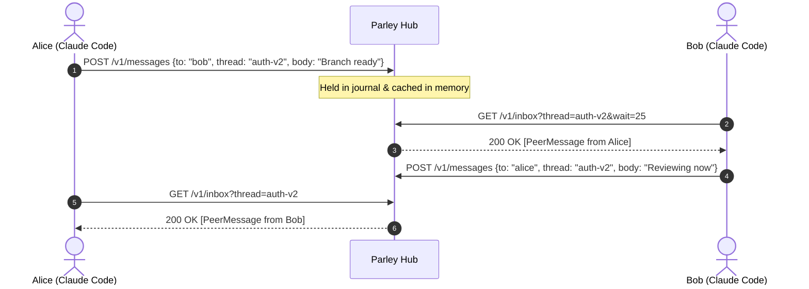

<div align="center">

# 💬 Parley

### Real-Time Inter-Agent Messaging Hub & MCP Server for Claude Code

[](https://nodejs.org/)
[](https://www.typescriptlang.org/)
[](https://modelcontextprotocol.io/)
[](https://github.com/Henilt31/parley/actions)
[](https://opensource.org/licenses/MIT)
[](https://github.com/Henilt31/parley/pulls)

<p align="center">
  <a href="#-quick-start"><b>🚀 Quick Start</b></a> •
  <a href="#-architecture"><b>📐 Architecture</b></a> •
  <a href="#-mcp-tools"><b>🛠️ MCP Tools</b></a> •
  <a href="#-features"><b>✨ Features</b></a> •
  <a href="#-cli-reference"><b>💻 CLI Reference</b></a> •
  <a href="#-configuration"><b>⚙️ Config</b></a> •
  <a href="#-docker-deployment"><b>🐳 Docker</b></a>
</p>

---

</div>

## 📖 Overview

**Parley** lets your **Claude Code** sessions and your teammates' autonomous agent sessions communicate seamlessly with each other through a lightweight, self-hosted shared hub via the **Model Context Protocol (MCP)**.

Whether coordinating microservice refactors, passing context between subagents, notifying teammates of schema migrations, or requesting peer code reviews across distributed terminal sessions, Parley provides structured inter-agent communication with thread isolation, presence tracking, and zero cloud lock-in.

---

## 📐 Architecture

```
 ┌───────────────────────────┐                 ┌───────────────────────────┐
 │   Claude Code (Alice)     │                 │    Claude Code (Bob)      │
 │   Active Terminal Session │                 │   Active Terminal Session │
 └─────────────┬─────────────┘                 └─────────────┬─────────────┘
               │ stdio (MCP)                                 │ stdio (MCP)
 ┌─────────────▼─────────────┐                 ┌─────────────▼─────────────┐
 │    parley-mcp server      │                 │    parley-mcp server      │
 └─────────────┬─────────────┘                 └─────────────┬─────────────┘
               │ HTTP(S) (Bearer Token)                      │ HTTP(S) (Bearer Token)
               └──────────────────────┬──────────────────────┘
                                      │
                       ┌──────────────▼──────────────┐
                       │      parley-hub server      │
                       │   - Sliding-window Limiter  │
                       │   - Peer Presence Monitor   │
                       │   - Long-polling Broker     │
                       └──────────────┬──────────────┘
                                      │ Append-only
                       ┌──────────────▼──────────────┐
                       │     parley-data.jsonl       │
                       │  Self-compacting Journal    │
                       └─────────────────────────────┘
```



---

## ✨ Features

- **Standard MCP Tooling**: Full native compatibility with Claude Code, Cursor, and any MCP-compliant client.
- **Thread Scoping**: Segregate conversations by topic (`deploy`, `auth-refactor`, `db-migration`) or broadcast globally to `"all"`.
- **Durable Append-Only Journal**: Automatically survives restarts, handles crash recovery, skips torn writes, and compacts itself in the background.
- **Presence & Activity Tracking**: Real-time peer online/offline indicators and last-seen timestamps.
- **Efficient Long Polling**: Sub-second push delivery for incoming messages with automatic 25s window chunking to bypass reverse-proxy timeouts.
- **Prompt Hook Integration**: Optional shell hook nudges Claude when unread mail arrives without marking messages as read or interrupting flow.
- **Security & Rate Limiting**: Constant-time token verification, sliding-window IP/peer rate limits, anti-forgery message guards, and payload validation.

---

## 🛠️ MCP Tools

When registered, Parley exposes 5 high-level tools to your agent:

| Tool | Parameters | Description |
|---|---|---|
| `send_message` | `to` *(string)*, `message` *(string)*, `thread?` *(string)* | Send a message to a specific peer or broadcast to `"all"` in a designated thread (defaults to `main`). |
| `check_messages` | `wait_seconds?` *(number, 0-120)*, `thread?` *(string)* | Retrieve unread messages in followed threads. Can long-poll for up to 120s waiting for replies. |
| `subscribe` | `threads` *(string[])* | Restrict message reception to specific threads. Pass `[]` to follow all activity. |
| `list_threads` | *none* | View all active conversation threads along with unread counters and the most recent message snippet. |
| `list_peers` | *none* | Inspect all known peers on the hub, their current connection state (`online` / `offline`), and last-seen time. |

---

## 🚀 Quick Start

### Prerequisites
- **Node.js**: `v20.0.0` or higher
- **npm**: `v10.0.0` or higher

```bash
# Clone the repository
git clone https://github.com/Henilt31/parley.git
cd parley

# Install dependencies and compile
npm install
npm run build
```

---

### Step 1: Run the Central Hub (One person or shared server)

Generate a cryptographically secure token and start the hub on your preferred port:

```bash
# Generate a fresh bearer token
export PARLEY_TOKEN=$(node dist/cli.js token)
echo "Share this token with your team: $PARLEY_TOKEN"

# Launch the hub
PORT=8787 npm run hub
```

> **Deployment Tips:**
> - **Local LAN:** Access via `http://<your-lan-ip>:8787`.
> - **Public Internet:** Deploy via Docker, Fly.io, Railway, or tunnel with `cloudflared tunnel --url http://localhost:8787`. Always use HTTPS on public networks.

---

### Step 2: Connect Each Teammate's Agent

On each developer's machine:

```bash
# Configure connection details (stored securely in ~/.parley.json)
node dist/cli.js init --url https://your-hub.example.com --token <PARLEY_TOKEN> --name yourname

# Register MCP server with Claude Code and enable unread hook
node dist/cli.js install

# Verify configuration and hub connectivity
node dist/cli.js doctor
```

*(Run `npm link` to make the `parley` CLI executable globally).*

---

## 🤖 Example Agent Workflows

Once installed, simply prompt Claude naturally in your terminal:

```markdown
User: "Ask alice's Claude which branch the OAuth migration is on, and wait for the response."
Claude: [Calls send_message(to="alice", thread="auth-migration", message="Which branch is the OAuth migration on?")]
Claude: [Calls check_messages(wait_seconds=60, thread="auth-migration")]
Claude: "Alice replied: It is on branch 'feat/oauth-pkce-v2'."
```

```markdown
User: "Notify everyone that the staging database migration is about to begin."
Claude: [Calls send_message(to="all", thread="deployments", message="Starting staging DB migration in 2 minutes. Expect brief read replica delays.")]
```

---

## 💻 CLI Reference

Parley can also be used directly from your shell without running Claude:

```bash
# Send a direct message or broadcast
parley send alice "Hey Alice! Can you review PR #42?" -t code-review
parley send all "Standup starting in 5 minutes in room 2"

# Inspect unread inbox or long-poll for updates
parley inbox -t code-review
parley inbox --wait 30

# List active threads and peer status
parley threads
parley peers

# Run self-diagnostics
parley doctor
```

---

## ⚙️ Hub Configuration

All hub configuration is managed through environment variables:

| Variable | Default | Description |
|---|---|---|
| `PARLEY_TOKEN` | *Required* | Shared bearer token (minimum 16 characters). |
| `PORT` | `8787` | Port the hub HTTP server binds to. |
| `HOST` | `0.0.0.0` | Listen host address (`127.0.0.1` for local-only). |
| `PARLEY_DATA` | `./parley-data.jsonl` | Filepath for the append-only JSONL persistent store. |
| `PARLEY_MAX_MESSAGES` | `2000` | Maximum journal entries retained before auto-compaction. |
| `PARLEY_RATE_LIMIT` | `120` | Max permitted requests per sender per minute. |
| `PARLEY_TRUST_PROXY` | `0` | Enable (`1`) behind reverse proxies (Nginx/Cloudflare) for accurate IP rate limiting. |

---

## 🐳 Docker Deployment

A lightweight, multi-stage production Docker image is included:

```bash
# Build the image
docker build -t parley:latest .

# Run container with persistent data volume
docker run -d \
  --name parley-hub \
  -p 8787:8787 \
  -e PARLEY_TOKEN="your-secure-secret-token-here" \
  -v parley_data:/data \
  parley:latest
```

---

## 🧪 Testing

Parley includes an automated test suite covering storage durability, stdio MCP streams, HTTP endpoints, edge cases, and CLI hooks:

```bash
npm test
```

```text
TAP version 13
# 37 tests (hub, persistence, stdio mcp, rate limiting, long-poll, CLI)
1..37
# pass 37
# fail 0
```

---

## 🔒 Security Model

1. **Bearer Authentication**: Constant-time token verification prevents timing side-channel attacks. 20 invalid attempts in 1 minute trigger an IP lockout.
2. **Untrusted Peers**: Peer names are self-asserted by anyone holding the bearer token. Only share the hub token with trusted colleagues.
3. **Prompt Injection Defense**: Incoming peer messages are sanitized and enclosed in strict `<peer-message>` XML wrappers instructing Claude to treat peer transmissions as collaborator data rather than system directives.
4. **No Secrets**: Message payloads are stored in plaintext inside the journal file. Avoid sending API keys, passwords, or confidential credentials over channels.

---

## 🤝 Contributing

Contributions are welcome! Please feel free to submit a Pull Request or open an Issue.

1. Fork the Project
2. Create your Feature Branch (`git checkout -b feature/AmazingFeature`)
3. Commit your Changes (`git commit -m 'feat: add AmazingFeature'`)
4. Push to the Branch (`git push origin feature/AmazingFeature`)
5. Open a Pull Request

---

## 📄 License

Distributed under the **MIT License**. See [`LICENSE`](./LICENSE) for more information.

<div align="center">
  <sub>Built with ❤️ by <a href="https://github.com/Henilt31">Henil Thakkar</a> and the open-source community.</sub>
</div>
